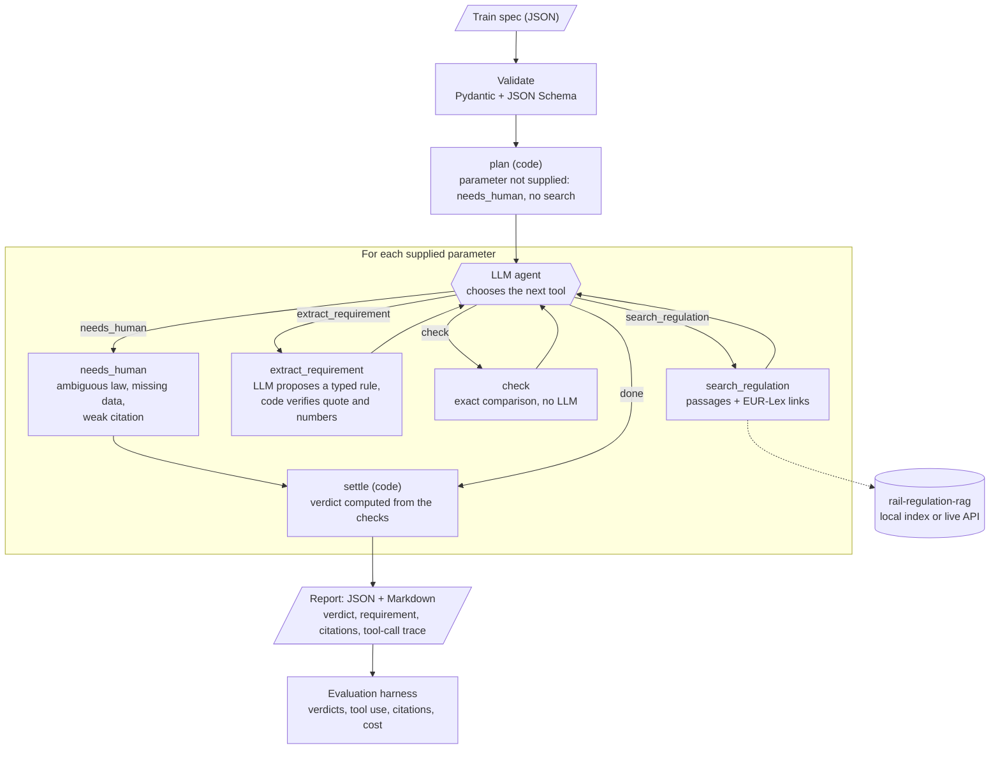

# rail-compliance-agent

[](https://github.com/cardohso/rail-compliance-agent/actions/workflows/ci.yml)
[](https://github.com/cardohso/rail-compliance-agent/actions/workflows/docker.yml)

A tool-using agent that checks a **train design spec** (JSON) against the **EU PRM TSI**
(Regulation (EU) No 1300/2014, accessibility for persons with reduced mobility) and returns a
compliance report with a verdict per parameter and a citation to the exact passage. It is built to
be **evaluated on how it uses its tools**, not only on its final text.

> **Not legal advice.** Reports are an engineering aid produced by software from the text of the
> regulation. They can be wrong or incomplete. Conformity is assessed by a notified body.

## In 30 seconds

- **Input:** a spec such as unit length, wheelchair spaces, door widths, step heights, toilets.
  **Output:** per parameter `pass`, `fail` or `needs_human`, the requirement, the spec value, and the
  quoted passage with its EUR-Lex link. JSON and Markdown.
- **How:** a LangGraph agent whose model chooses among four tools: `search_regulation` (it calls my
  [rail-regulation-rag](https://github.com/cardohso/rail-regulation-rag) assistant),
  `extract_requirement`, `check` and `needs_human`. The model never touches a number it could
  mis-copy, and **code, not the model, decides every verdict** (see
  [design decisions](#design-decisions)).
- **Evaluation:** a hand-written golden set (20 specs, 43 verdicts) scores verdicts, tool selection,
  argument correctness, citations and escalation, with thresholds written *before* the first run.
  The first run **failed** its gate (34/43 verdicts); after principled fixes it passes (43/43), and a
  separate held-out set written before running scored 18/19. Those are small samples from one
  reviewer; read [Limitations](#limitations) before trusting any of them.
- **Also:** a FastAPI service (`POST /check`), an MCP server exposing the four tools, a non-root
  Docker image with a healthcheck, and a CI gate that fails the build below the thresholds.

## Architecture



The same four tools are also exposed over MCP and the whole loop over HTTP; the evaluation scores the
tool-call trace that every report carries.

## How it uses the rail assistant

[rail-regulation-rag](https://github.com/cardohso/rail-regulation-rag) is my RAG assistant over the
Interoperability Directive and six TSIs (hybrid BM25 + vector search over a Qdrant index, cited
answers, deployed on Azure). `search_regulation` reaches it three ways behind one interface:

| Backend | What it is | Used for |
|---|---|---|
| `local` (default) | the assistant's own retrieval step run in-process: same embedder, same index, hybrid search, **no LLM, no network** | evaluation and the Docker image, so runs do not spend the live demo's quota |
| `live` | the deployed `POST /ask` (its generated answer and refusals come back too), with retry and backoff | trying the live assistant |
| `replay` | recorded results from a file | offline tests |

The `local` backend installs `rail-regulation-rag` as a git dependency **pinned to one commit**
(`d63cc5f`), and the corpus and index must be that same commit; a test fails if the pin differs
between `pyproject.toml`, the Dockerfile and the eval workflow. Search results are cached on disk.

## Run it locally

You need [uv](https://docs.astral.sh/uv/), Python 3.12, and a free
[Gemini API key](https://aistudio.google.com/apikey) (never commit it; `.env` is git-ignored).

```bash
# 1. get the code and its dependencies (includes the rail assistant's retrieval library)
git clone https://github.com/cardohso/rail-compliance-agent
cd rail-compliance-agent
uv sync --group local

# 2. get the rail assistant's corpus at the pinned commit and build its search index
#    (embeds ~1,600 passages on CPU: about 3 minutes, mostly the first-time model download and encoding)
git clone https://github.com/cardohso/rail-regulation-rag ../rail-regulation-rag
git -C ../rail-regulation-rag checkout d63cc5f37fcc93100b7bc25a61a63d4507d24248
RAIL_RAG_DATA_DIR=../rail-regulation-rag/data uv run python -m rail_rag.index

# 3. add your key
cp .env.example .env     # then edit .env and set GEMINI_API_KEY=...

# 4. check a spec
uv run python -m rail_compliance check examples/02_noncompliant_regional.json
```

I followed exactly these steps in a clean clone (no cache, no `.env`, no sibling folders) on
2026-10-24 (macOS, uv 0.12, Python 3.12) and they work as written.

This writes `reports/02_noncompliant_regional.json` and `.md` and prints a verdict per parameter. A
check makes roughly 5 to 30 model requests (see [Cost](#cost-and-quota)). Without a key or the
index, the offline parts still work: `uv run pytest`, `uv run python -m rail_compliance.spec validate
examples/*.json`, and the MCP `check` tool.

### The input

A JSON file validated by [`rail_compliance.spec`](src/rail_compliance/spec.py) (the JSON Schema is at
[`schema/train-spec.schema.json`](schema/train-spec.schema.json)). Scope is the PRM TSI rolling-stock
rules (point 4.2.2):

| Field | Unit | Rule it feeds |
|---|---|---|
| `unit_length_m` (required) | m, excluding any power head | wheelchair spaces per unit length (Table 5) |
| `length_includes_power_head` | bool | says the length is only an upper bound on the TSI's basis |
| `design_speed_kmh` | km/h | wheelchair door width (below 250 km/h) |
| `wheelchair_spaces` | count | 4.2.2.2 |
| `exterior_doors.clear_width_mm`, `.wheelchair_door_clear_width_mm`, `.wheelchair_door_level_access` | mm, bool | 4.2.2.3.2 |
| `steps.external_step_height_mm`, `.internal_step_height_mm` | mm | 4.2.2.11.2 |
| `toilets.fitted`, `.universal`, `.universal_door_clear_width_mm` | count, mm | 4.2.2.5, 5.3.2.4 |

Everything except `name` and `unit_length_m` is optional: a parameter the spec omits is reported as
`needs_human` (missing data), not as a failure. Unknown fields are rejected, so a typo cannot silently
drop a parameter. [`examples/`](examples) has three specs.

### The report

Per parameter: verdict, requirement, spec value, citations (document, section, EUR-Lex link, the
exact quote), plus the agent's tool-call trace and cost. Verdicts are `pass`, `fail`, `needs_human`,
and `not_applicable` for a rule whose conditions are false for this spec (a toilet rule on a train
with no toilets).

A real report, from a fresh clone running `examples/02_noncompliant_regional.json` with
`gemini-3.5-flash-lite` (20 tool calls, 24 model calls, 51 s; abridged):

```markdown
# Compliance report: Regional train with several violations

**Summary:** 1 pass, 5 fail, 1 needs human

| Parameter | Spec value | Requirement | Verdict |
|---|---|---|---|
| `wheelchair_spaces` | 1 | ≥ 2 | **fail** |
| `exterior_doors.clear_width_mm` | 780 mm | ≥ 800 mm | **fail** |
| `exterior_doors.wheelchair_door_clear_width_mm` | 900 mm | ≥ 1000 mm; ≥ 800 mm | **fail** |
| `steps.external_step_height_mm` | 250 mm | ≤ 230 mm | **fail** |
| `steps.internal_step_height_mm` | 190 mm | ≤ 200 mm | **pass** |
| `toilets.universal` | 0 | ≥ 1 | **fail** |
| `toilets.universal_door_clear_width_mm` | not supplied | - | **needs human** |

## `exterior_doors.wheelchair_door_clear_width_mm`: fail
900 mm violates >= 1000 mm
[PRM TSI, Annex §4.2.2.3.2](https://eur-lex.europa.eu/legal-content/EN/TXT/?uri=CELEX:02014R1300-20230928):
> (2) On trains with a design speed lower than 250 km/h, wheelchair access doors offering a level
> access as defined in point 2.3 shall have a minimum clear useable width of 1 000 mm when open.
```

## The tools

Four plain functions with typed inputs and outputs in
[`src/rail_compliance/tools/`](src/rail_compliance/tools):

| Tool | What it does | LLM? |
|---|---|---|
| `search_regulation(question)` | passages of the regulation that answer the question | no (`local`) |
| `extract_requirement(passages, parameter)` | the numeric rule as a typed `Requirement` (a limit or a table, unit, conditions) | yes, then **verified without it** |
| `check(spec_value, requirement)` | `pass` / `fail` / `needs_human` / `not_applicable` by exact comparison | no |
| `needs_human(reason)` | records an escalation: ambiguous law, missing data, weak citation | no |

## Evaluation

The golden set is 20 specs and 43 scored verdicts written by hand from the TSI text, with traps: values
exactly at a limit, a rule that depends on unit length, conditional rules, an exception that needs
a demonstration, and cases that should end in `needs_human`
([reasoning and limits](eval/GOLDEN_SET_REVIEW.md)). Metrics are deterministic (no model judges
anything) and each carries its numerator, denominator and a 95% Wilson interval:

| Metric | Meaning |
|---|---|
| `verdict_accuracy` | agent verdict equals the golden verdict |
| `unsafe_pass_rate` | agent says `pass` where the golden verdict is `fail` or `needs_human` |
| `needs_human_recall` / `_precision` | expected escalations it made / its escalations that were expected |
| `tool_selection_accuracy` | the expected tools were called, in order (search, extract, then check or needs_human) |
| `argument_correctness` | `check` was called with the right parameter and the spec's own value |
| `citation_hit_rate` | a cited passage is the gold passage that holds the rule |
| tool calls, latency | cost; latency excludes rate-limit waits and replays cached calls' original time |

Retrieval, citations and grounding also run through [goldpass](https://github.com/cardohso/goldpass)
(my regression-test tool for RAG systems) for its report and gate. The tool-use metrics live in this
repo because goldpass has no notion of tool calls.

[`eval/thresholds.yaml`](eval/thresholds.yaml) was committed **before the first full run** and has not
been changed since. `eval.yml` runs the set on pull requests and by hand and fails the build below
those numbers.

### Results

Gemini `gemini-3.5-flash-lite`, local search. Full tables and caveats:
[run 01 diagnosis](eval/results/run-01/DIAGNOSIS.md), [run 02](eval/results/run-02/RESULT.md),
[held-out](eval/results/heldout-01/RESULT.md).

| | Run 01 (first run) | Run 02 (after fixes) | Held-out (10 new specs) | **GitHub CI, same code as run 02** | Required |
|---|---|---|---|---|---|
| verdict accuracy | 34/43 = 0.79 | 43/43 = 1.00 | 18/19 = 0.95 | **40/43 = 0.93** | ≥ 0.80 |
| false passes (said pass; golden fail or needs_human) | 0/43 | 0/43 | 0/19 | 0/43 | ≤ 0.05 |
| escalation recall / precision | 3/5 / 3/9 | 5/5 / 5/5 | 2/2 / 2/3 | 5/5 / 5/8 | ≥ 0.40 / 0.60 |
| tool selection / argument correctness / citation hit | 43/43 / 59/59 / 43/43 | 43/43 / 56/56 / 43/43 | 19/19 / 23/23 / 19/19 | 40/43 / 55/55 / 40/40 | ≥ 0.80 / 0.95 / 0.90 |
| quality gate | **failed** (4 checks) | passed | passed | passed; **goldpass grounding failed** (0.93 < 0.95) | |

How to read this:

- **Run 01 failed.** Nine wrong verdicts, in four causes (an exception rule extracted as
  unconditional; a condition invented on an optional flag; a general rule not applied once a special
  one did not apply; a real rule attributed to the wrong parameter). I fixed those with general
  mechanisms, not special cases (contingencies, interval-valued inputs, rule subjects); see
  [design decisions](#design-decisions).
- **Run 02 is a development-set result.** I designed the fixes from run 01's misses on that same set,
  so 43/43 shows the fixes work on the cases that motivated them, not that the agent would score
  that on new specs.
- **The held-out set is the fairer number, and it is small.** Ten specs and 19 verdicts, verdicts
  committed before the agent was run on them, run once. The one miss (h10) was predicted in writing
  beforehand: `check` returns `needs_human` when a condition is unknown even if the value passes
  either way. It tests new values and combinations, **not new rules** (all seven rules were in the
  dev set). 18/19 and 43/43 cannot be told apart at this size (95% interval for 18/19 is 0.75-0.99).
- **The same code scored differently on GitHub.** `eval.yml`'s first full run, from a fresh cache, got
  40/43 where local run 02 got 43/43, and its goldpass gate **failed** on grounding (0.93 against
  0.95). All three differences were one parameter (`toilets.universal`) in three specs: the
  extraction model, called without a focus, did not read "a universal toilet shall be provided" as a
  minimum of one and the agent escalated without a check. That is a real gap in the extraction prompt
  (the verifier handles that wording, the prompt does not), exposed by sampling. I have **not** fixed it
  or touched a threshold; see [`eval/results/ci-run-01/RESULT.md`](eval/results/ci-run-01/RESULT.md) and
  [the run](https://github.com/cardohso/rail-compliance-agent/actions/runs/40175097116). It is the first
  measurement of run-to-run variance, and it says the 43/43 and 18/19 above are single, partly
  favourable draws.
- **Tool selection, argument and citation scores were at or near 100% in every run**, so they did not
  separate a failing run from a passing one: they show an orderly process, not a correct verdict.

```bash
uv sync --group local --group eval
uv run python -m rail_compliance.evaluation run                        # all 20 specs
uv run python -m rail_compliance.evaluation run --cases g04,g05        # a few
uv run python -m rail_compliance.evaluation run --golden-dir eval/heldout \
    --thresholds eval/heldout/thresholds.yaml --out eval/results/heldout
uv run python -m rail_compliance.evaluation gate eval/results/local
uv run goldpass run --config eval/goldpass/goldpass.yaml
```

### Cost and quota

A fresh full run makes about 245 model requests (the cache entries it leaves; retries after
rate-limit errors may add a few). Gemini's free tier allows 500 requests per day per Google project for
this model and 15 per minute, so about one fresh full run fits in a day, and the CI workflow draws on
the same key's quota. Every successful call is cached by its full prompt: a run that stops on the quota
resumes where it stopped (re-run the same command; this happened during development), and a re-run
of unchanged code costs nothing.

## API, MCP server, Docker

**API.** `uv run uvicorn rail_compliance.api:create_app --factory --port 8000`. `GET /health` answers
while the process is up (`ready` says whether `/check` can run); `POST /check` takes a spec and
returns the report (`?format=markdown` for Markdown). It is rate-limited per client (2 a minute, 20 a
day by default) because one check can use up to ~30 of the free tier's 500 daily requests. Invalid
specs get a 422 that names the field; model or search outages get 503 or 502, never a 500.

**MCP server.** The four tools and a `rail://parameters` resource over stdio, for any MCP client.
`check` and `needs_human` need nothing; `search_regulation` needs the index (or `SEARCH_BACKEND=live`);
`extract_requirement` needs a key. Missing pieces return a readable tool error naming the fix.

```bash
claude mcp add rail-compliance -- uv run --directory /path/to/rail-compliance-agent python -m rail_compliance.mcp_server
```

```console
$ uv run python examples/mcp_client_demo.py        # starts the server over stdio, real output
tools: search_regulation, extract_requirement, check, needs_human
check(780 mm): fail, 780 mm violates >= 800 mm
check(800 mm): pass, 800 mm meets >= 800 mm
needs_human: {"parameter": null, "category": "weak_citation", "reason": "The rule points to an external standard."}
rail://parameters: 7 parameters, first: wheelchair_spaces
```

I tested the server with the Python MCP client only, not with Claude Desktop or Claude Code (the
registration command above is the standard one).

**Docker.** `docker build -t rail-compliance-agent .` then
`docker run --rm -p 8000:8000 --env-file .env rail-compliance-agent`. The image holds the corpus at the
pinned commit with its index built at build time (search needs no network), runs as uid 1000 and has
a healthcheck; the key is passed at run time, never baked in. Verified by the `docker` workflow on
GitHub (build, non-root, `healthy`, `/health` ready, `/check` on a spec needing no model, search from
the baked-in index with no network). Not verified: a real `/check` with a real key inside the container,
and I have not run the image on my own machine. Qdrant's local mode lets only one process open the
index, so the API runs one worker and nothing else may open the same index in that container.

## Design decisions

- **The model chooses tools; code holds the numbers.** The model passes passage and requirement *ids*,
  not text, and the runtime resolves them. A `check` call whose `spec_value` differs from the spec is
  rejected and recorded, so the verdict never uses a mis-copied value and argument correctness is
  still measurable.
- **Extraction is verified, not trusted.** The model must quote the rule word for word; code confirms
  the quote is in the cited passage and that every number in the rule (limit, table bounds, thresholds)
  appears in it. A rule that fails is `unverified` and never reaches `check`. This catches invented
  numbers; it cannot catch a real rule applied to the wrong thing, which is what the *subject* rule
  below is for.
- **Verdicts are computed by code.** The model's explicit `needs_human` is binding (its doubt is not
  overruled; failed checks stay in the report); otherwise `fail` beats a check that needed a person,
  which beats `pass`. Run 01 showed why: the model had escalated correctly and my aggregation threw it
  away.
- **`check` is exact and never guesses.** "30 to 205 metres" includes both ends, "more than 205"
  excludes 205, metres convert to millimetres without float error; missing data, an unconvertible
  unit or a table with a gap is `needs_human`.
- **Rules carry a subject.** Each extracted rule is labelled with what it is stated for ("all exterior
  doorways", "wheelchair doorways"). A parameter is governed by rules for its own subject and broader
  ones, never narrower: the general door rule governs wheelchair doors, but a wheelchair-door rule
  does not govern the narrowest door.
- **Exceptions keep their contingency.** "May be increased to 230 mm if it can be demonstrated ..."
  is recorded as contingent; it can turn a fail into `needs_human` but never into a pass.
- **A qualifier is not a condition.** `length_includes_power_head` says the stated length is only an
  upper bound. `check` evaluates tables and conditions over that whole interval, so a verdict that
  would change inside it is `needs_human` and one that would not is decided.
- **Escalation is a tool.** `needs_human` is a recorded action, so the evaluation can score it for
  precision and recall.
- **Thresholds before results.** `eval/thresholds.yaml` was committed before the first run. It then
  failed that run, and I fixed the agent instead of the numbers.
- **Reuse goldpass where it fits.** Retrieval, citation and grounding go through goldpass. Its
  golden items need empty gold passages for "refuse" items, and a `needs_human` case still has a rule
  to find, so escalation is scored in this repo, not mapped onto refusal.
- **Everything free and cached.** A client-side throttle stays under the free tier's 15 requests a
  minute; every successful model and search call is cached by its full prompt, with its original
  latency, so a re-run costs nothing and an interrupted run resumes.

## Limitations

- **Narrow scope.** Seven parameters of one regulation (PRM TSI rolling stock). Not other TSIs, not
  the station, infrastructure or operating rules, not measurements the spec cannot express (for
  example wheelchair-space dimensions).
- **New units only.** Appendix F exempts parts of several rules at renewal or upgrade; the spec has
  no field for that, so every case assumes a unit placed on the market after 28 September 2023.
  Exemptions that depend on data the spec lacks (for example a low platform height) are not applied.
- **The corpus is a snapshot** (the consolidated PRM TSI of 28 September 2023, as ingested by the
  rail assistant at a pinned commit). Later amendments are not reflected.
- **Small golden set, one reviewer.** 20 specs, 43 verdicts, only 5 expecting `needs_human` and 1
  `not_applicable`, written by me and not checked by anyone else. The tags `table-boundary` (4) and
  `exception` (2) rest on a handful of cases. A test checks the verdicts are arithmetically
  consistent with the rules and that the quotes exist in the corpus; it cannot check that I read the
  law correctly.
- **The headline numbers are optimistic.** The dev-set result was tuned on the set that exposed
  the misses; the held-out set tests new values, not new rules, and has 19 verdicts. No cross-document
  case exists because the rest of the corpus says nothing about these parameters.
- **One model, not reproducible to the digit.** Results are for `gemini-3.5-flash-lite`, whose sampling
  the provider fixes. A fresh run of the same code differed: 40/43 on GitHub against 43/43 locally
  (one run each, so the size of the variance is still only roughly known). The cache pins a run, not
  the model. Other models are untested.
- **A known weakness (h10).** An unknown condition makes a rule `needs_human` even when the value
  passes whether or not the condition applies. Safe, but unhelpful.
- **Verdicts are right more reliably than explanations.** In one case the verdict was correct but the
  model's written reason rambled and contradicted itself. No metric scores explanations.
- **A known prompt gap.** The extraction prompt does not say that "X shall be provided" is a minimum of
  one; the verifier does. When the agent calls extraction without a focus the model can answer "no numeric
  requirement" and the agent escalates (the CI run's three misses). Unfixed.
- **Free-tier limits shape everything.** 500 requests a day means about one fresh full evaluation
  a day, and CI shares that quota. A fork's pull request gets no secret, so its eval is skipped.
- **Untested surfaces.** The MCP server was exercised with the Python client only; the Docker image
  was built and probed on GitHub, not on my machine, and not with a real key.
- **Not legal advice**, and not a substitute for conformity assessment.

## Repository layout

```
src/rail_compliance/
  spec.py, models.py, parameters.py   input schema, typed objects, parameters and rule subjects
  tools/                              search, extract, check, needs_human
  agent.py, llm.py, report.py         the LangGraph loop, model adapters + caches, the report
  api.py, mcp_server.py, cli.py       FastAPI service, MCP server, command line
  evaluation/                         metrics, gate, runner, goldpass export
  golden.py                           golden-set loader, gold rules and oracle
eval/specs/, eval/heldout/            dev set (20 specs) and held-out set (10 specs), with review notes
eval/thresholds.yaml                  the quality gate, committed before the first run
eval/results/                         run 01, run 02, held-out results with diagnoses
examples/, schema/                    example specs, MCP client demo, JSON Schema
```

## Development

```bash
uv sync
uv run ruff check . && uv run ruff format --check .
uv run pytest              # offline: no network, no API key, the model is mocked
```

Tests that need the rail assistant's index or goldpass are skipped unless `uv sync --group local --group eval`
has been run and `RAIL_RAG_DATA_DIR` points at a built index. CI (`ci.yml`) runs lint and the offline
tests on every push; `docker.yml` builds and probes the image; `eval.yml` runs the evaluation on pull
requests and by hand (it needs the repository secret `GEMINI_API_KEY`).

## Licence

MIT
